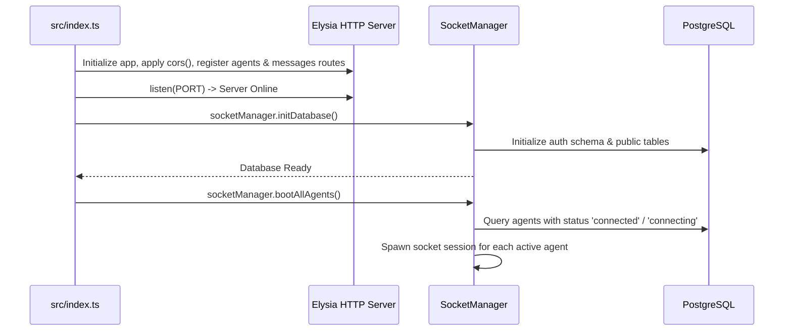

# 🚀 Server Entrypoint (`src/index.ts`)

> [!NOTE]
> This file is the primary entrypoint for the Hoshino Backend application. It is responsible for initializing the Elysia web framework, registering CORS middleware, routing, executing database schema initialization, and booting active agent sessions.

---

## 📋 File Overview

- **Workspace Path**: `Hoshino-Backend/src/index.ts`
- **Runtime**: Bun (`bun run index.ts`)
- **Default Port**: `3040` (or configured via ENV `PORT`)
- **Core Dependencies**:
  - `elysia`: HTTP & WebSocket framework
  - `@elysiajs/cors`: Cross-Origin Resource Sharing middleware
  - `[[Hoshino-Backend/modules/baileys/socket|SocketManager]]`: Multi-tenant Baileys engine
  - `[[Hoshino-Backend/routes/agents|agentRoutes]]`: Route `/api/agents`
  - `[[Hoshino-Backend/routes/messages|messageRoutes]]`: Route `/api/agents/:id/messages` & `/ws`
  - `[[Hoshino-Backend/utils/utils#logger|logger]]`: Logger with automatic caller stack-trace tracking

---

## ⚙️ Execution Flow & Logic

---

## 🔍 Variables & Handlers

### `const app = new Elysia()`
Initializes the Elysia HTTP server instance:
- `.use(cors())`: Enables CORS for frontend dashboard interactions.
- `.get("/", ...)`: Health check endpoint returning `{ status: "online", service: "Hoshino Backend" }`.
- `.use(agentRoutes)`: Mounts agent management routes (`/api/agents`).
- `.use(messageRoutes)`: Mounts messaging and real-time WebSocket routes (`/api/agents/:id/...`).
- `.listen(PORT)`: Starts listening on the configured HTTP port.

### `socketManager.initDatabase().then(...)`
- Initializes tables `auth.credentials`, `auth.keys`, `public.agents`, `public.chats`, `public.messages`, etc.
- Emits system log: `Hoshino Backend running at http://...`.
- Calls `await socketManager.bootAllAgents()` to restore any bot sessions that were active prior to shutdown.
- Catches initialization errors via `logger.error`.
