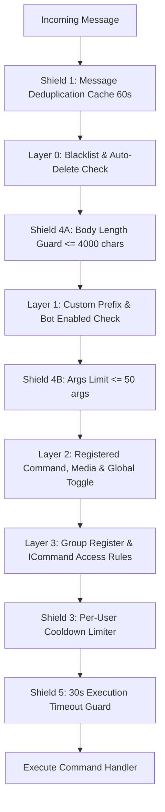

# ⚡ Dynamic Command Loader & Execution Pipeline (`src/services/commandLoader.ts`)

> [!NOTE]
> This file acts as the **Bot Command Router and Orchestrator**. It implements dynamic filesystem command discovery and a **3-Layer Security Pipeline** equipped with 5 Security Shields (Anti-Spam, Cooldown, Deduplication, ReDoS Guard, and Execution Timeout).

---

## 📋 Class Overview: `CommandLoader` (Singleton)

- **Workspace Path**: `Hoshino-Backend/src/services/commandLoader.ts`
- **Global Instance**: `commandLoader = CommandLoader.getInstance()`
- **Command Directory**: `Hoshino-Backend/src/commands/`

---

## 🛡️ 5 Security Shields Architecture

1. **Shield 1 (Deduplication Cache)**: Drops duplicate incoming messages with identical IDs within 60 seconds using `NodeCache`.
2. **Shield 2 & 3 (Cooldown / Rate Limiter)**: Prevents command spamming per user (`key: agentId:senderJid:commandName`). Owners and Masters bypass cooldown.
3. **Shield 4 (Input Overflow & ReDoS Guard)**:
   - Truncates body length to 4000 characters (`body.slice(0, 4000)`).
   - Limits argument count to 50 (`args.slice(0, 50)`).
4. **Shield 5 (30s Execution Timeout)**: Uses `Promise.race()` to enforce a hard 30-second cancellation threshold on deadlocked command promises.

---

## 🛠️ Complete Method Reference

### 1. `init(): Promise<void>`
- **Signature**: `public async init(): Promise<void>`
- **Description**: Traverses subfolders in `src/commands/` recursively, dynamically importing command modules via `import()`, and registers triggers in `this.commands`.

### 2. `loadCommandsFromDir(dir: string): Promise<void>`
- **Signature**: `private async loadCommandsFromDir(dir: string): Promise<void>`
- **Description**: Recursively scans directories, automatically deriving `command.category` from folder names (e.g., `bluearchive`, `downloaders`, `group`, `owner`, `utility`, `waifuImages`).

### 3. `getAllCommands(): ICommand[]`
- **Signature**: `public getAllCommands(): ICommand[]`
- **Description**: Returns all distinct `ICommand` instances (deduplicating aliases) for help menu generation.

### 4. `executeMessage(agentId: string, sock: WASocket, rawMsg: WAMessage): Promise<void>`
- **Signature**: `public async executeMessage(agentId: string, sock: WASocket, rawMsg: WAMessage): Promise<void>`
- **Execution Stages**:
  1. **Layer 0 - Blacklist**: Resolves all sender identities (`@lid` and `@s.whatsapp.net` via `extractSenderIdentities` & `resolveUserIdentities`) and verifies if any identity is blacklisted via `[[Hoshino-Backend/repositories/command.repository#3-blacklist-publicagent_blacklists|commandRepository.isBlacklisted()]]` (with `lidMapping` cross-sync). Drops message if true.
  2. **Layer 0 - Auto-Delete**: Checks if any of the sender's resolved identities is marked for auto-delete in this specific group or globally via `[[Hoshino-Backend/repositories/command.repository#4-auto-delete-targets-publicagent_autodeletes|commandRepository.isAutoDelete(agentId, jid, senderIdentities)]]`. Deletes message and exits if true.
  3. **Layer 1 - Group Listening**: If in group, reads settings via `commandRepository.getGroupSettings()`. If `botEnabled: false`, only permits activation commands (`enablebot`, `bot`, `listen`).
  4. **Layer 1 - Prefix Match**: Checks whether body begins with custom or default prefixes (`.`, `!`, `/`, `#`).
  5. **Layer 2 - Command Lookup**: Matches trigger against registered commands.
  6. **Layer 2 - Media Validation**: If command specifies `allowedMediaTypes`, verifies that the message or quoted message contains an allowed format.
  7. **Layer 2 - Global Toggle**: Verifies global active status via `[[Hoshino-Backend/repositories/command.repository#6-command-toggles-matrix--group-policies|commandRepository.isCommandEnabledGlobally(agentId, allCommandNames)]]`. Inspects all command aliases so disabling a command cannot be bypassed via trigger aliases.
  8. **Layer 3 - Group Policy & Registration**: If in group, verifies command permission via `[[Hoshino-Backend/repositories/command.repository#6-command-toggles-matrix--group-policies|commandRepository.isCommandAllowedInGroup(agentId, jid, allCommandNames, needAdminRegisterThisCommand)]]`. Blocks explicitly disabled commands in `public.agent_group_commands` across all aliases, requires admin registration if `needAdminRegisterThisCommand: true`, and exempts `enablecmd`/`disablecmd` from lockout.
  9. **Layer 3 - Role & Environment Controls**:
     - `inGroup`: Must be in group chat.
     - `access: 'owner' | 'master'`: Must have owner role in `public.agent_owners`.
     - `inGroupAccess: 'admin'`: Sender must be group admin or bot owner.
     - `botAdminRequired`: Bot must be group admin.
  10. **Shield Cooldown**: Checks per-user cooldown window (default: 2 seconds, owner exempt).
  11. **Execution**: Dispatches `command.execute(args, ctx)` under the 30-second timeout guard.
