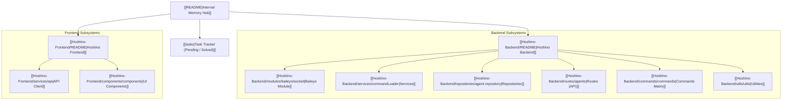

# 🌌 Hoshino Workspace - Internal Memory Hub (Obsidian Vault)

> [!NOTE]
> This file is the **Primary Map of Content (MOC)** serving as the AI Agent's persistent internal memory.
> The AI Agent consults this documentation before performing raw source code scans to ensure fast, token-efficient, and accurate codebase navigation.

---

## 🧭 Subsystem Navigation Map

---

## 📁 Mirrored Workspace Structure

| Original Directory | Memory Note (Obsidian) | Architectural Scope |
| :--- | :--- | :--- |
| `docs/tasks.md` | [[tasks\|Task Tracker]] | Central ledger for ongoing, pending, and solved project tasks |
| `Hoshino-Backend/src/index.ts` | [[Hoshino-Backend/index\|Server Entrypoint]] | HTTP server initialization (Elysia), DB boot, & agent auto-connect |
| `Hoshino-Backend/src/modules/baileys/` | [[Hoshino-Backend/modules/baileys/socket\|Baileys Socket & Auth]] | Multi-instance WhatsApp engine, PostgreSQL auth, event dispatching |
| `Hoshino-Backend/src/services/` | [[Hoshino-Backend/services/commandLoader\|Services Layer]] | Dynamic command loading, 3-layer security pipeline, WS broadcaster |
| `Hoshino-Backend/src/repositories/` | [[Hoshino-Backend/repositories/agent.repository\|Repositories]] | PostgreSQL persistence layer (auth, agents, chats, messages, gacha) |
| `Hoshino-Backend/src/routes/` | [[Hoshino-Backend/routes/agents\|Routes & Endpoints]] | Elysia REST API & WebSocket endpoints |
| `Hoshino-Backend/src/commands/` | [[Hoshino-Backend/commands/commands\|Commands]] | Bot command modules (Blue Archive, Utility, Group, Owner, Downloaders) |
| `Hoshino-Backend/src/utils/` | [[Hoshino-Backend/utils/utils\|Utilities]] | Bun SQL client, ANSI Logger, sticker converter, external scrapers |
| `Hoshino-Frontend/src/` | [[Hoshino-Frontend/README\|Frontend UI]] | React + Vite + Modern Web Console dashboard |

---

## ⚡ AI Agent Memory Protocols
1. **Memory First**: Always inspect documentation files in this folder prior to scanning raw `.ts`/`.tsx` source files.
2. **Continuous Sync**: When adding or updating methods/functions in code, immediately update the corresponding markdown note in `docs/`.
3. **Language Rule**: All code and documentation must strictly be written in English.
4. **Obsidian Conventions**: Maintain `[[...]]` wikilinks, YAML frontmatter tags, and callout blocks for Obsidian graph navigation.
5. **Task Tracking**: Record all ongoing, pending (`⏳ Pending`), and completed (`✅ Solved`) tasks in [[tasks|Task Tracker (`docs/tasks.md`)]].
