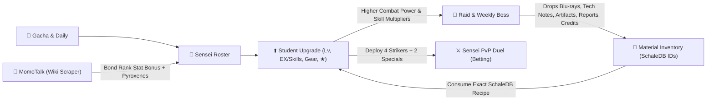

# 📋 Hoshino Workspace - Task Tracker

> [!NOTE]
> Central ledger tracking **Pending**, **In Progress**, and **Solved** tasks across the Hoshino workspace, accompanied by **Pre-Implementation Thinking & Architecture Plans** in accordance with `.agents/rules/task-tracking-rule.md`.

---

## 🧭 Navigation
- **Root MOC**: [[README|Internal Memory Hub]]
- **Subsystems**: [[Hoshino-Backend/README|Hoshino Backend]] | [[Hoshino-Frontend/README|Hoshino Frontend]]
- **Related Domain Docs**: [[Hoshino-Backend/commands/commands|Commands Matrix]] | [[Hoshino-Backend/repositories/gacha_momo.repository|Gacha & MomoTalk Repositories]] | [[Hoshino-Backend/utils/utils|SchaleDB Utility]]

---

## ⏳ Ongoing & Pending Tasks

| ID | Task Description | Status | Related Modules | Updated |
| :--- | :--- | :--- | :--- | :--- |
| _None_ | _All scheduled Blue Archive RPG, Raid, MomoTalk & PvP tasks have been solved._ | — | — | — |

### Active Checklist
_No pending tasks currently queued._

---

## 🧠 Thinking & Initial Architecture Plans

> [!IMPORTANT]
> The architectural blueprints below unify `TASK-002`, `TASK-003`, `TASK-004`, and `TASK-005` into a cohesive **Kivotos RPG Progression Loop**:
> **Gacha / Daily** ➔ **Raid & Weekly Boss (Earn SchaleDB Materials + Credits)** ➔ **Upgrade Students (Level, Skills, Gear, Stars)** ➔ **MomoTalk Bond Bonus** ➔ **Sensei PvP Duel (Betting)**.

---

### 1. `TASK-002`: Student Upgrade System via SchaleDB Materials
- **Objective**: Allow Senseis to view and upgrade their owned students using the **exact authentic materials** defined in SchaleDB for each specific student.
- **Data Sources (`SchaleDB`)**:
  1. `https://schaledb.com/data/en/students.json` (Already cached locally in `data/schaledb/students.json`):
     - Contains per-student `SkillExMaterial` (4 arrays for EX Lv 1➔5), `SkillExMaterialAmount`, `SkillMaterial` (9 arrays for Basic/Enhanced/Sub Lv 1➔10), `SkillMaterialAmount`.
     - Contains `Equipment` array (3 slots, e.g. `["Hat", "Hairpin", "Watch"]`) and Unique Gear (`Gear.TierUpMaterial`, `Gear.TierUpMaterialAmount`).
     - Contains base and Lv.100 stats: `AttackPower1`..`AttackPower100`, `MaxHP1`..`MaxHP100`, `DefensePower1`..`DefensePower100`, `HealPower1`..`HealPower100`.
  2. `https://schaledb.com/data/en/items.json` (To be cached in `data/schaledb/items.json`):
     - Maps numeric Material IDs (e.g., `3030` = *Gehenna Blu-ray (Beginner)*, `4030` = *Gehenna Tech Notes (Beginner)*, `150` = *Nebra Sky Disk / Voynich Manuscript / Rohonc Codex* Ooparts/Artifacts, `10`..`13` = *Activity Reports*) to their official English names, icons (`https://schaledb.com/images/item/icon/{icon}.webp`), and rarity tiers (`N`, `R`, `SR`, `SSR`).
  3. `https://schaledb.com/data/en/equipment.json` (To be cached in `data/schaledb/equipment.json`):
     - Maps equipment categories (`Hat`, `Gloves`, `Shoes`, `Bag`, `Badge`, `Hairpin`, `Amulet`, `Watch`, `Necklace`) and Blueprint Tier upgrades (`T1 ➔ T9`).
- **Database Schema Extensions (`src/utils/db.ts`)**:
  - Alter `public.sensei_profiles`: Add `credits BIGINT DEFAULT 500000`, `sensei_level INT DEFAULT 1`, `sensei_exp INT DEFAULT 0`.
  - Alter `public.sensei_students`: Add:
    - `level INT DEFAULT 1` (1 to 90/100)
    - `exp INT DEFAULT 0`
    - `ex_skill_level INT DEFAULT 1` (1 to 5)
    - `normal_skill_level INT DEFAULT 1` (1 to 10)
    - `passive_skill_level INT DEFAULT 1` (1 to 10)
    - `sub_skill_level INT DEFAULT 1` (1 to 10)
    - `equip_slot1_tier INT DEFAULT 1`, `equip_slot2_tier INT DEFAULT 1`, `equip_slot3_tier INT DEFAULT 1` (T1 to T9)
    - `weapon_star INT DEFAULT 0` (Unique Weapon UE30/UE40/UE50 unlocked at `5★`)
  - Create `public.sensei_inventory`:
    - `(agent_id, user_jid, item_id INT, item_name TEXT, category TEXT, count INT, PRIMARY KEY (agent_id, user_jid, item_id))` — stores authentic SchaleDB item IDs (Activity Reports, School Blu-rays, School Tech Notes, Oopart Artifacts, Equipment Blueprints, Eligma).
- **Commands & UX Flow**:
  - `.upgrade <student> [level | ex | skill | gear | star]`:
    - Without action arg: Shows the student's current build card (Level, Calculated ATK/HP/DEF/HEAL, EX & Skill levels, Equipment Tiers, Combat Power) AND lists the exact SchaleDB materials needed for the next upgrade alongside how many the Sensei currently owns in their inventory (`✅ 12/12 Gehenna Blu-ray (Beginner)`).
    - `.upgrade <student> level [targetLv]`: Consumes Activity Reports (`item_id: 10..13`) + Credits to increase Student Level and interpolate stats (`AttackPower1 ➔ AttackPower100`).
    - `.upgrade <student> ex`: Consumes the student's exact `SkillExMaterial[currentEx - 1]` and `SkillExMaterialAmount[currentEx - 1]` from SchaleDB + Credits to level up EX Skill (`Lv.1 ➔ Lv.5`).
    - `.upgrade <student> skill [normal|passive|sub]`: Consumes `SkillMaterial` + `SkillMaterialAmount` to level up Basic/Passive/Sub skills (`Lv.1 ➔ Lv.10`).
    - `.upgrade <student> gear [1|2|3]`: Upgrades equipment slot 1/2/3 from `T1 ➔ T9` using blueprints.
    - `.upgrade <student> star`: Uses duplicate copies / Eleph (`count`) to Mystic Liberate (`1★ ➔ 2★ ➔ 3★ ➔ 4★ ➔ 5★`) instead of only burning duplicates for Pyroxenes!
  - `.inventory` / `.bag` / `.materials`: View owned SchaleDB materials, Activity Reports, Blu-rays, Tech Notes, Artifacts, and Credits.

---

### 2. `TASK-003`: Interactive Total Assault Raid Boss & Weekly Boss System
- **Objective**: Transform `.raid` from a static wiki viewer into a playable **Total Assault (Raid Boss)** and **Weekly Boss (Bounty / Scrimmage / Grand Assault)** combat mode that drops the SchaleDB materials required by `TASK-002`.
- **Data Sources (`SchaleDB`)**:
  - `https://schaledb.com/data/en/raids.json` contains:
    - `Raid`: All Total Assault bosses (*Binah, Chesed, Shiro & Kuro, Hieronymus, Kaiten FX Mk.0, Perorodzilla, Hod, Goz, Gregorius, Hovercraft, Kurokage, Geburah*, etc.) with `ArmorType`, `BulletType`, `BulletTypeInsane`, `Terrain`, and skill/stat profiles.
    - `TimeAttack` / `WorldRaid` / `EliminationRaid`: Grand Assault & special bosses.
- **Gameplay Mechanics**:
  1. **Weekly Rotating Raid Boss (`Total Assault`) & Daily/Weekly Bounty (`Weekly Boss`)**:
     - Global/Agent active Weekly Raid Boss with difficulty tiers:
       - `Normal` (Rec. Lv 15)
       - `Hard` (Rec. Lv 30)
       - `VeryHard` (Rec. Lv 45)
       - `Hardcore` (Rec. Lv 60)
       - `Extreme` (Rec. Lv 70)
       - `Insane` (Rec. Lv 80 — Boss gains `BulletTypeInsane` attack checks against Student Armor!)
       - `Torment` (Rec. Lv 90)
  2. **Squad Formation (`.squad` / `.party`)**:
     - Sensei can set their active squad (`4 Strikers + 2 Specials`) or auto-pick their highest-synergy owned students for the boss's Armor & Terrain.
  3. **Combat Calculation Engine**:
     - Computes each deployed student's effective stats based on:
       - Student Level (`1-90`), Star Grade (`1★-5★`, `+10%` to `+40%` stat multiplier), EX & Sub Skill multipliers (`Skills.Ex`, `Skills.Public`, `Skills.Passive`), Equipment Tiers (`T1-T9`), and MomoTalk Bond Rank bonus (`FavorStatValue`).
       - **Type Affinity Matrix (Authentic Blue Archive Formula)**:
         - Attack vs Armor: Weak = `2.0x` (`Explosive` vs `LightArmor`, `Piercing` vs `HeavyArmor`, `Mystic` vs `Unarmed`, `Sonic` vs `ElasticArmor`), Normal = `1.0x`, Resisted = `0.5x`.
         - Terrain Adaptation (`StreetBattleAdaptation`, `OutdoorBattleAdaptation`, `IndoorBattleAdaptation` `0..5`): `S (1.2x)`, `A (1.1x)`, `B (1.0x)`, `C (0.9x)`, `D (0.8x)`.
  4. **Rewards & Material Drops (Feeding `TASK-002`)**:
     - Clearing a Raid or Weekly Boss drops:
       - **Activity Reports** (for leveling students)
       - **School Blu-rays & Tech Notes** (matching the school of the students in Sensei's squad or random Kivotos academies!)
       - **Oopart Artifacts** (matching the exact `SkillExMaterial` / `SkillMaterial` IDs needed by Sensei's owned students so material drops are always relevant and usable!)
       - **Equipment Blueprints**, **Credits**, **Raid Coins**, and **Pyroxene Clear Bonus**.
     - Daily Raid Ticket limit (e.g. 3 Raid Tickets/day + 3 Weekly Boss Bounties) to keep economy balanced.

---

### 3. `TASK-004`: Game-Accurate MomoTalk System (Web Scraping + Authentic UI/Flow)
- **Objective**: Upgrade `.momotalk` so it feels just like in-game MomoTalk and works across the Blue Archive roster using real scraped MomoTalk transcripts rather than only 8 hardcoded students.
- **Where to Scrape Authentic MomoTalk Data (Web Sources)**:
  1. **Primary Scraper — `bluearchive.wiki` MediaWiki API (`https://bluearchive.wiki/w/api.php`)**:
     - Why `bluearchive.wiki`? It is clean, ad-free, has no Cloudflare JS challenge blocking server `fetch`, and stores structured MomoTalk transcripts per student at `<Student_Name>/MomoTalk` or inside `Category:MomoTalk`!
     - API Endpoint to fetch structured wikitext/HTML:
       - `https://bluearchive.wiki/w/api.php?action=parse&page=${encodeURIComponent(studentName)}/MomoTalk&prop=wikitext|text&format=json`
       - Also supports searching via `action=query&list=search&srsearch=${studentName}+MomoTalk&format=json`.
     - **Persistent Disk Cache**: Once a student's MomoTalk page is scraped and parsed into structured episodes (`Title`, `BondRankRequired`, `Messages[]`, `SenseiChoices[]`, `StudentReplies[]`, `MemorialLobbyUnlock`), it is cached to `data/schaledb/momotalk/{studentId}.json` so subsequent talks are instant (0ms network latency).
  2. **Secondary Source — `blue-archive.fandom.com` API (`https://bluearchive.fandom.com/api.php`)**:
     - Fallback MediaWiki endpoint (`<Student_Name>/Relationship_Story` or `/MomoTalk`) if a newer JP/Global student's MomoTalk page isn't yet formatted on `bluearchive.wiki`.
  3. **Tertiary Fallback — Dynamic Character-Accurate Generator (SchaleDB Profile + Gemini AI)**:
     - If a brand-new or collab student has no translated transcript on either wiki yet, automatically synthesize an in-character MomoTalk episode using the student's `ProfileIntroduction`, `Hobby`, `CharacterSSRNew`, `School`, and `Club` from `students.json`, then cache it locally.
- **How to Make It Feel Like In-Game MomoTalk**:
  1. **Visual MomoTalk Chat Card Generator (`sharp` + SVG-to-PNG)**:
     - Render an authentic **MomoTalk UI Card Image** sent directly to WhatsApp!
     - Features the iconic pink MomoTalk header bar (`MomoTalk | Heart Bond Rank Badge`), the student's circular SchaleDB icon (`https://schaledb.com/images/student/icon/{id}.webp`), student chat bubbles on the left, Sensei's blue reply box on the right, Bond Point (`♥ +Relationship Rank Up!`) banner, and the `Reply [1] / [2]` prompt!
  2. **Multi-Turn Episode Flow & Relationship Story Bridge**:
     - Matches the real game: Student sends opening text bubbles ➔ Sensei picks a reply bubble (`1` or `2`) ➔ Student reacts with follow-up bubbles ➔ If the episode triggers a **Relationship Story Event**, narrates the short Bond Episode scene and unlocks the student's **Memorial Lobby (Live2D Artwork)** (`https://schaledb.com/images/student/lobby/{id}.webp`) at the student's authentic `MemoryLobby` bond rank from `students.json`!
     - **Stat Bonus Integration**: Raising Bond Rank grants the student's authentic `FavorStatType` and `FavorStatValue` (e.g., `+ATK`, `+HP`) from `students.json` for Raids and PvP Duels!

---

### 4. `TASK-005`: Sensei-vs-Sensei Tactical PvP Duel with Betting (`.duel`)
- **Objective**: Allow Senseis in a WhatsApp group (or via mention/reply) to challenge each other to a **Tactical Challenge (PvP Duel)** with a Pyroxene or Credit bet (`taruhan`).
- **Commands & Interactive Flow**:
  1. **Challenge Creation**:
     - `.duel @target <bet_amount> [pyroxene|credit]` (or reply to another Sensei's message with `.duel 500`).
     - Validates both Challenger and Opponent have:
       - At least 1 owned student (up to `4 Strikers + 2 Specials` deployed from their `.squad` or auto-selected top Combat Power roster).
       - Sufficient Pyroxene (or Credit) balance to cover `<bet_amount>`.
     - Creates an in-memory pending duel session (2-minute TTL) with an anti-double-spend lock.
  2. **Accept / Decline**:
     - Opponent types `.duel accept` (or `.accept`) or `.duel decline`.
     - Upon `.duel accept`, an **atomic SQL transaction** locks/deducts `<bet_amount>` from both Senseis and runs the **Tactical PvP Simulation Engine**.
  3. **Tactical PvP Simulation Engine**:
     - Selects battle terrain (`Street`, `Outdoor`, or `Indoor`) or uses current daily PvP season terrain.
     - Evaluates both teams (`4 Strikers` on frontline + `2 Specials` providing backline stat support + EX skills):
       - **Student Stats**: Level, Star Grade (`1★-5★`), Equipment Tiers (`T1-T9`), Bond Bonus, and Skill Levels (`EX` + `Basic/Passive/Sub`).
       - **Armor vs Bullet Counter Matrix**: e.g., if Sensei A's *Mika* (`Piercing`) hits Sensei B's *Hoshino* (`HeavyArmor`), Mika deals `2.0x` Weak damage; if hitting *Yuuka* (`HeavyArmor`), `2.0x`; if hitting *Aru* (`LightArmor`), `0.5x` Resisted.
       - **3-Round Turn-by-Turn Combat Log**:
         - *Phase 1 (Opening Volleys & Positioning)*
         - *Phase 2 (EX Skill Clashes — uses real EX Skill names from SchaleDB!)*
         - *Phase 3 (Climax / Decisive Finisher & MVP Student)*
  4. **Payout & Leaderboard**:
     - Winner receives `2 × bet_amount` (100% pot payout, zero house tax or configurable) + PvP Win tally.
     - Displays a rich battle summary with each team's Combat Power, EX Skills triggered, MVP student, and updated Pyroxene/Credit balances.

---

## ✅ Solved Tasks

| ID | Task Description | Status | Related Modules | Solved Date |
| :--- | :--- | :--- | :--- | :--- |
| `TASK-001` | Create agent rule (`.agents/rules/task-tracking-rule.md`) and initialize `docs/tasks.md` to track ongoing, pending, and solved tasks | ✅ Solved | [[README\|Internal Memory Hub]] | 2026-10-29 |
| `TASK-002` | **Blue Archive Student Upgrade System**: Upgrade student Level (`1➔90`), Star/Mystic Liberation (`1★➔5★ + UE 1★-3★`), Skills (`EX 1➔5` & `Basic/Passive/Sub 1➔10`), and Equipment (`T1-T9`) using authentic material requirements mapped from SchaleDB (`students.json`, `items.json`, `equipment.json`), plus `.inventory` and `.squad` | ✅ Solved | [[Hoshino-Backend/utils/utils\|schaledb.ts]], [[Hoshino-Backend/repositories/gacha_momo.repository\|gacha.repository.ts]], [[Hoshino-Backend/commands/commands\|upgrade.ts]] | 2026-10-29 |
| `TASK-003` | **Interactive Total Assault Raid Boss & Weekly Boss System**: Playable PvE Raid (`.raid attack`) & Weekly Boss Bounty (`.weeklyboss`) combat using `raids.json`, calculating armor/terrain damage, tracking boss HP/scores/leaderboards, and dropping smart SchaleDB upgrade materials & Pyroxenes | ✅ Solved | [[Hoshino-Backend/commands/commands\|raid.ts]], [[Hoshino-Backend/repositories/gacha_momo.repository\|gacha.repository.ts]], [[Hoshino-Backend/utils/utils\|schaledb.ts]] | 2026-10-29 |
| `TASK-004` | **Game-Accurate MomoTalk System with Web Scraping & UI Rendering**: Scrape authentic student MomoTalk episodes & dialogue trees from `bluearchive.wiki` MediaWiki API (`/w/api.php`) with local caching (`data/schaledb/momotalk/`), visual MomoTalk UI chat card rendering (`sharp` SVG-to-PNG), and Bond Stat bonuses | ✅ Solved | [[Hoshino-Backend/utils/utils\|momotalkScraper.ts]], [[Hoshino-Backend/commands/commands\|momotalk.ts]], [[Hoshino-Backend/repositories/gacha_momo.repository\|momo.repository.ts]] | 2026-10-29 |
| `TASK-005` | **Sensei-vs-Sensei Tactical PvP Duel with Betting (`Tactical Challenge`)**: Interactive PvP challenge (`.duel @sensei <bet> [pyroxene\|credit]`, `.duel accept`, `.duel decline`, `.duel rank`) with 3-phase `4 Striker + 2 Special` squad combat simulation and atomic pot payout | ✅ Solved | [[Hoshino-Backend/commands/commands\|duel.ts]], [[Hoshino-Backend/repositories/gacha_momo.repository\|gacha.repository.ts]] | 2026-10-29 |

### Completed Checklist
- [x] **`TASK-001`**: Create agent rule (`.agents/rules/task-tracking-rule.md`) and initialize `docs/tasks.md` to track ongoing, pending, and solved tasks (`Solved` - 2026-10-29)
- [x] **`TASK-002`**: Blue Archive Student Upgrade System with SchaleDB Materials (`Solved` - 2026-10-29)
- [x] **`TASK-003`**: Interactive Total Assault Raid Boss & Weekly Boss System (`Solved` - 2026-10-29)
- [x] **`TASK-004`**: Game-Accurate MomoTalk System with Web Scraping & Visual Flow (`Solved` - 2026-10-29)
- [x] **`TASK-005`**: Sensei-vs-Sensei Tactical PvP Duel with Betting (`Solved` - 2026-10-29)
